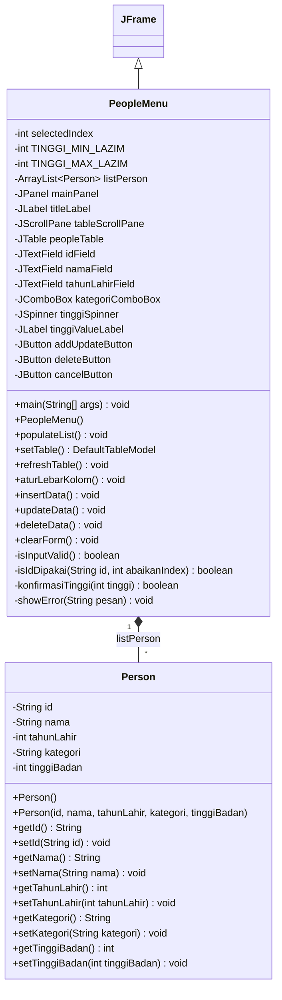
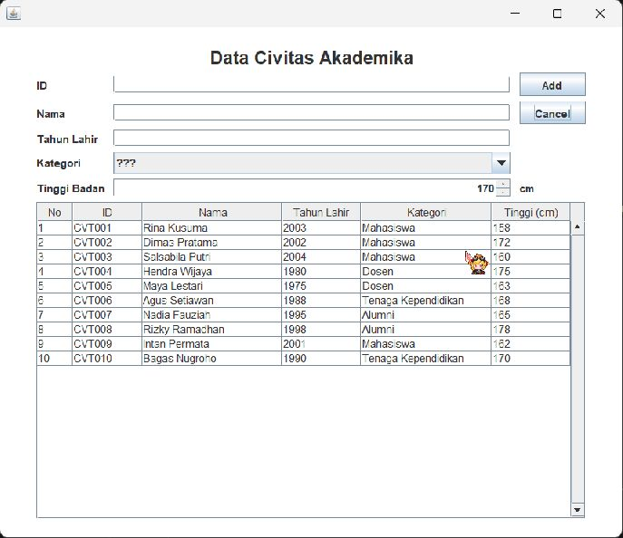
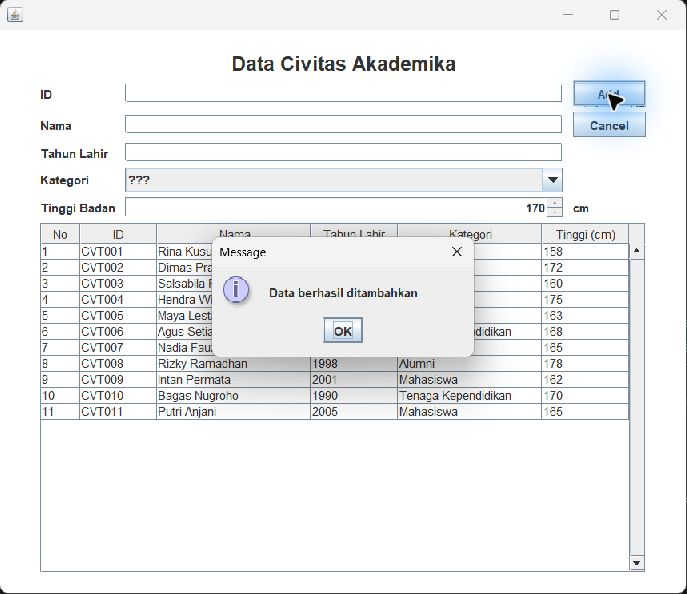
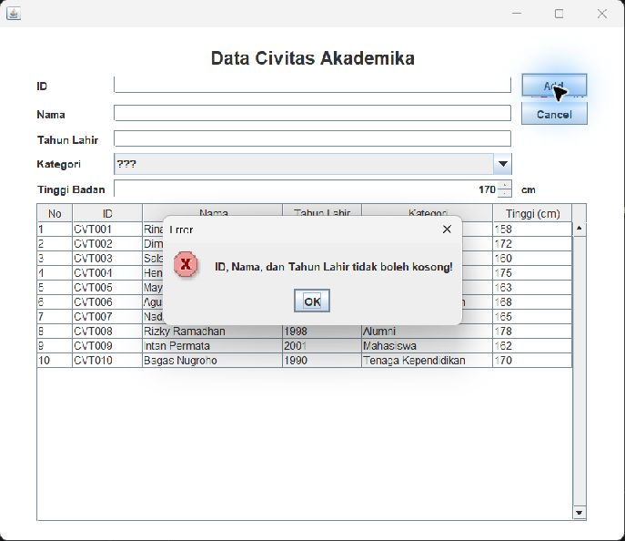
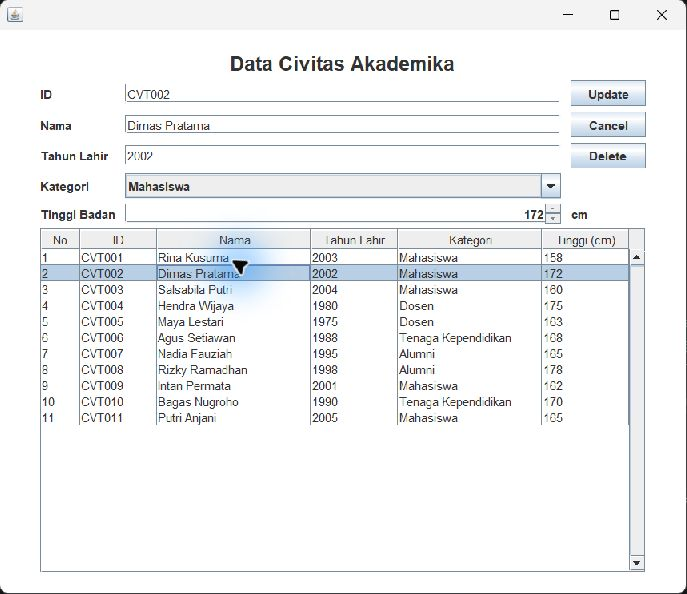
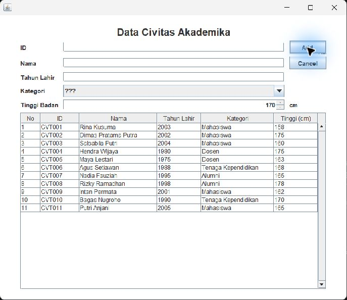
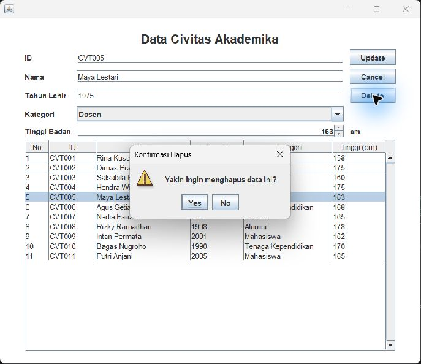
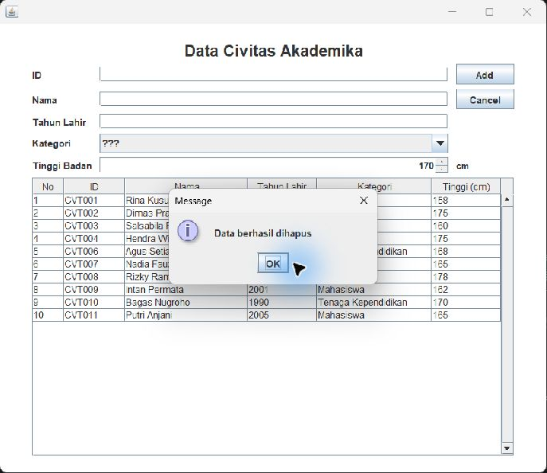
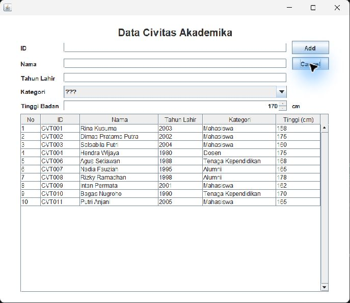

# JANJI

Saya Muhammad Fadey Rafif dengan NIM 2504792 mengerjakan Tugas Praktikum 4 dalam mata kuliah Desain dan Pemrograman Berorientasi Objek untuk keberkahanNya maka saya tidak melakukan kecurangan seperti yang telah dispesifikasikan. Aamiin.

# STRUKTUR FILE

```text
TP4/
├── PeopleData/                  
│   ├── src/
│       ├── Person.java
│       ├── PeopleMenu.java
│       └── PeopleMenu.form
│   
│   
├── dokumentasi/
|
│   ├── 01-tampilan-awal.png
│   ├── 02-create-data.png
│   ├── 03-create-validasi-error.png
│   ├── 04-read-klik-baris.png
│   ├── 05-update-data.png
│   ├── 06-delete-konfirmasi.png
│   ├── 07-delete-berhasil.png
│   └── 08-cancel.png
|
└── readme.md
```

# 🧑‍🎓 TEMA PROGRAM

Aplikasi desktop **Java Swing GUI** bertema **Data Civitas Akademika** untuk mengelola data warga kampus melalui operasi **CRUD** (Create, Read, Update, Delete). Data disimpan sementara dalam `ArrayList<Person>` dan ditampilkan pada `JTable` menggunakan `DefaultTableModel`.

Program mengikuti pola latihan ProductData pada modul, dengan tambahan:

1. **Konfirmasi Yes/No sebelum menghapus data**, menggunakan `JOptionPane.showConfirmDialog()`.
2. **Atribut `tinggiBadan`**, dengan input **JSpinner** bernama `tinggiSpinner`. Komponen ini digunakan sebagai variasi input selain JTextField untuk bagian bonus.

Program memiliki dua class: `Person` sebagai model data dan `PeopleMenu` sebagai GUI sekaligus pengatur CRUD. Data tidak disimpan ke database atau file. Setelah aplikasi ditutup dan dijalankan lagi, isinya kembali ke data awal dari `populateList()`.

# Diagram Konsep



# ☕️ Class & Atribut

**1. Person**

| Atribut | Tipe | Keterangan |
| --- | --- | --- |
| `id` | String | Identitas unik warga kampus. Pemeriksaan duplikat tidak membedakan huruf besar dan kecil. |
| `nama` | String | Nama warga kampus. |
| `tahunLahir` | int | Tahun lahir, divalidasi dari 1900 sampai tahun saat program dijalankan. |
| `kategori` | String | Mahasiswa, Dosen, Tenaga Kependidikan, atau Alumni. |
| `tinggiBadan` | int | Tinggi badan dalam sentimeter, diisi melalui JSpinner. |

`Person` memiliki constructor kosong, constructor dengan lima parameter, serta getter dan setter untuk setiap atribut.

**2. PeopleMenu**

- `selectedIndex` menyimpan indeks baris yang dipilih. Nilai `-1` berarti mode Add.
- `listPerson` menyimpan objek-objek Person dalam ArrayList.
- `TINGGI_MIN_LAZIM = 30` dan `TINGGI_MAX_LAZIM = 300` digunakan untuk menentukan kapan konfirmasi tinggi badan ditampilkan.
- Field Swing terhubung dengan komponen yang memiliki nama binding sama dalam `PeopleMenu.form`.

# 🖥️ Desain GUI

Form disusun menggunakan **Swing UI Designer** pada `PeopleMenu.form`, dengan layout **GridLayoutManager (IntelliJ)**.

| Component | Field name | Fungsi |
| --- | --- | --- |
| JPanel | `mainPanel` | Panel utama jendela. |
| JLabel | `titleLabel` | Judul Data Civitas Akademika. |
| JTextField | `idField` | Input ID. |
| JTextField | `namaField` | Input nama. |
| JTextField | `tahunLahirField` | Input tahun lahir. |
| JComboBox | `kategoriComboBox` | Pilihan kategori; `???` berarti belum memilih. |
| JSpinner | `tinggiSpinner` | Input tinggi badan, nilai awal 170, minimum 1, langkah 1. |
| JLabel | `tinggiValueLabel` | Menampilkan satuan `cm`. |
| JButton | `addUpdateButton` | Add untuk menambah, berubah menjadi Update ketika baris dipilih. |
| JButton | `cancelButton` | Mengosongkan form dan membatalkan mode edit. |
| JButton | `deleteButton` | Menghapus data setelah konfirmasi; muncul saat baris dipilih. |
| JScrollPane | `tableScrollPane` | Area scroll tabel. |
| JTable | `peopleTable` | Menampilkan data warga kampus. |

Window berukuran 700 × 600 dan ditampilkan di tengah layar. Panel utama berlatar putih dengan jarak atas/bawah 20 piksel dan kiri/kanan 40 piksel. Judul menggunakan font tebal ukuran 20. Scrollbar vertikal selalu ditampilkan, area kosong tabel mengikuti warna tabel, dan `aturLebarKolom()` mengatur lebar masing-masing kolom.

Model spinner tidak memasang batas atas khusus. Nilainya berupa bilangan bulat; tinggi di luar 30–300 cm memerlukan persetujuan pengguna sebelum disimpan. Tinggi dapat diubah melalui tombol panah spinner. Jika mengetik nilai langsung, tekan Enter atau pindah fokus dengan Tab untuk menerapkan isian.

# 🔁 Alur Program

```text
MULAI
  |
  +-- main() membuat objek PeopleMenu
  |     +-- constructor mengisi list dan tabel
  |     +-- menyiapkan combo box dan spinner
  |     +-- menyembunyikan Delete dan memasang listener
  |
  +-- main() mengatur window dan menampilkannya
  |
  +-- pengguna melakukan aksi
  |     +-- Add    -> validasi -> insertData() -> refreshTable() -> clearForm()
  |     +-- klik baris -> data masuk ke form -> mode Update
  |     +-- Update -> validasi -> ubah objek -> refreshTable() -> clearForm()
  |     +-- Delete -> dialog konfirmasi
  |     |             +-- Yes -> deleteData() -> refreshTable() -> clearForm()
  |     |             +-- No / tutup dialog -> data tetap ada
  |     +-- Cancel -> clearForm()
  |
  +-- window ditutup -> program berhenti
SELESAI
```

| Method | Penjelasan |
| --- | --- |
| `main()` | Membuat objek PeopleMenu, mengatur ukuran, posisi, panel, warna, dan perilaku saat window ditutup. |
| `PeopleMenu()` | Constructor yang menyiapkan data, komponen form, tabel, dan listener. |
| `populateList()` | Memasukkan 10 data contoh dengan ID CVT001 sampai CVT010. |
| `setTable()` | Membuat DefaultTableModel dari ArrayList, dengan kolom No, ID, Nama, Tahun Lahir, Kategori, dan Tinggi (cm). |
| `refreshTable()` | Memasang model tabel terbaru lalu memanggil `aturLebarKolom()`. |
| `aturLebarKolom()` | Mengatur lebar kolom agar sesuai dengan isinya. |
| `insertData()` | Memvalidasi form, membuat objek Person baru, dan menambahkannya ke list. |
| `updateData()` | Memvalidasi form dan mengubah objek pada `selectedIndex` melalui setter. |
| `deleteData()` | Menghapus objek pada `selectedIndex`. Konfirmasi dilakukan oleh listener tombol sebelum method ini dipanggil. |
| `clearForm()` | Mengosongkan teks, mengembalikan kategori ke `???` dan tinggi ke 170, menghilangkan pilihan tabel, serta kembali ke mode Add. |
| `isInputValid()` | Memeriksa field wajib dan pilihan kategori. |
| `isIdDipakai()` | Memeriksa ID duplikat; saat Update, indeks objek yang sedang diubah diabaikan. |
| `konfirmasiTinggi()` | Meminta konfirmasi jika tinggi kurang dari 30 atau lebih dari 300 cm. |
| `showError()` | Menampilkan dialog error. |

# ❌ Error Handling & Validasi

- ID, nama, dan tahun lahir tidak boleh kosong atau hanya berisi spasi.
- Kategori `???` dianggap belum dipilih.
- Tahun lahir harus dapat dibaca sebagai bilangan bulat. `NumberFormatException` ditangani melalui try-catch.
- Tahun lahir harus berada di rentang 1900 sampai tahun saat aplikasi dijalankan, menggunakan `Year.now().getValue()`.
- ID tidak boleh sama dengan warga lain. ID sendiri tetap boleh digunakan saat Update.
- Tinggi di luar 30–300 cm menampilkan konfirmasi. Yes melanjutkan penyimpanan; No atau menutup dialog membatalkannya.
- Delete menampilkan konfirmasi Yes/No sebelum menghapus data.

Pesan kesalahan ditampilkan melalui JOptionPane. Ketika validasi form gagal, operasi Add/Update dibatalkan.

Perubahan data dilakukan melalui form dan tombol Update. Pada implementasi ini sel tabel masih bisa diedit langsung karena memakai DefaultTableModel bawaan; edit langsung tersebut tidak memperbarui ArrayList dan dapat hilang saat tabel disegarkan.

# 🧪 TEST CASE

Skenario berikut digunakan untuk memeriksa program. Kolom hasil yang diharapkan menjelaskan perilaku yang perlu diperiksa, bukan klaim bahwa seluruh variasi input telah diuji.

Pengujian langsung melalui GUI mencakup tampilan awal, input tinggi 165 cm, tambah data CVT011, validasi form kosong, pemilihan baris, perubahan nama dan tinggi CVT002, konfirmasi penghapusan CVT005, pembatalan penghapusan CVT007 dengan No, serta Cancel. Hasilnya sesuai dengan alur yang dijelaskan dan ditunjukkan pada screenshot di bawah.

| No | Skenario | Langkah / Input | Hasil yang diharapkan |
| --- | --- | --- | --- |
| TC-01 | Tampilan awal | Jalankan PeopleMenu. | Tabel memuat CVT001–CVT010, field kosong, kategori `???`, tinggi 170, tombol Add, dan Delete tersembunyi. |
| TC-02 | Tinggi badan | Gunakan panah spinner atau ketik 165 lalu Enter/Tab. | Nilai tinggi berubah dan dapat dibaca saat penyimpanan. |
| TC-03 | Create valid | Isi CVT011, Putri Anjani, 2005, Mahasiswa, 165; tekan Add. | Data baru muncul dan dialog berhasil ditampilkan. Form kembali kosong dengan tinggi 170. |
| TC-04 | Field kosong | Tekan Add ketika form kosong. | Error `ID, Nama, dan Tahun Lahir tidak boleh kosong!`. |
| TC-05 | Kategori belum dipilih | Isi field wajib tetapi biarkan kategori `???`. | Error `Pilih kategori terlebih dahulu!`. |
| TC-06 | Tahun bukan angka | Isi tahun `abc`, field lain valid. | Error `Tahun lahir harus berupa angka!`. |
| TC-07 | Tahun di luar rentang | Isi tahun 1850 atau tahun setelah tahun sekarang. | Error rentang tahun; data tidak disimpan. |
| TC-08 | ID duplikat | Tambahkan data dengan ID CVT001 atau cvt001. | Error `ID sudah dipakai, gunakan ID lain!`. |
| TC-09 | Read | Klik baris CVT002. | Form menampilkan Dimas Pratama, 2002, Mahasiswa, 172; tombol Update dan Delete muncul. |
| TC-10 | Update valid | Pilih CVT002, ubah nama menjadi Dimas Pratama Putra dan tinggi menjadi 175. | Baris CVT002 berubah; jumlah data tetap. |
| TC-11 | Update ID duplikat | Pilih CVT003 dan ubah ID menjadi CVT001. | Error duplikat; data lama tetap tersimpan. |
| TC-12 | Update ID sendiri | Pilih data, ubah nama/tinggi tanpa mengganti ID. | Update berhasil. |
| TC-13 | Batalkan Delete | Pilih baris, tekan Delete, lalu No atau tutup dialog. | Data tetap ada. |
| TC-14 | Setujui Delete | Pilih CVT005, tekan Delete, lalu Yes. | Baris dihapus, nomor diurutkan ulang, dan form dibersihkan. |
| TC-15 | Cancel | Pilih CVT007, lalu Cancel. | Form kosong, kategori `???`, tinggi 170, tombol Add, Delete tersembunyi, dan pilihan tabel dibersihkan. |
| TC-16 | Tinggi tidak lazim | Isi data valid dengan tinggi 301, lalu Add/Update. | Dialog konfirmasi tinggi; No membatalkan, Yes menyimpan. |
| TC-17 | Tutup dan buka ulang | Tutup aplikasi lalu jalankan kembali. | Data kembali ke 10 data awal karena penyimpanan hanya di ArrayList. |

# DOKUMENTASI OUTPUT

## Tampilan awal (data dari populateList)



## Create (tambah data)



### Create dengan validasi error



## Read (klik baris tabel, data masuk ke form)



## Update (ubah data)



## Delete (dengan konfirmasi)

### Pop-up konfirmasi sebelum hapus



### Data berhasil dihapus



## Cancel (mengosongkan form)


